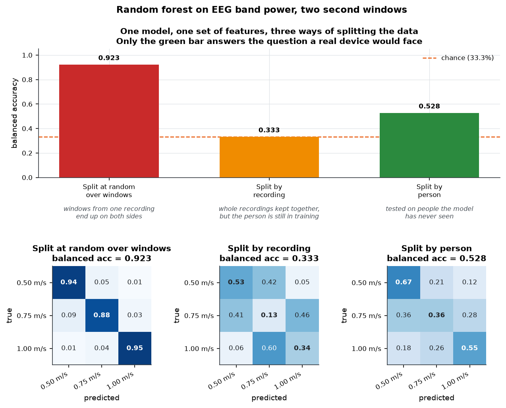
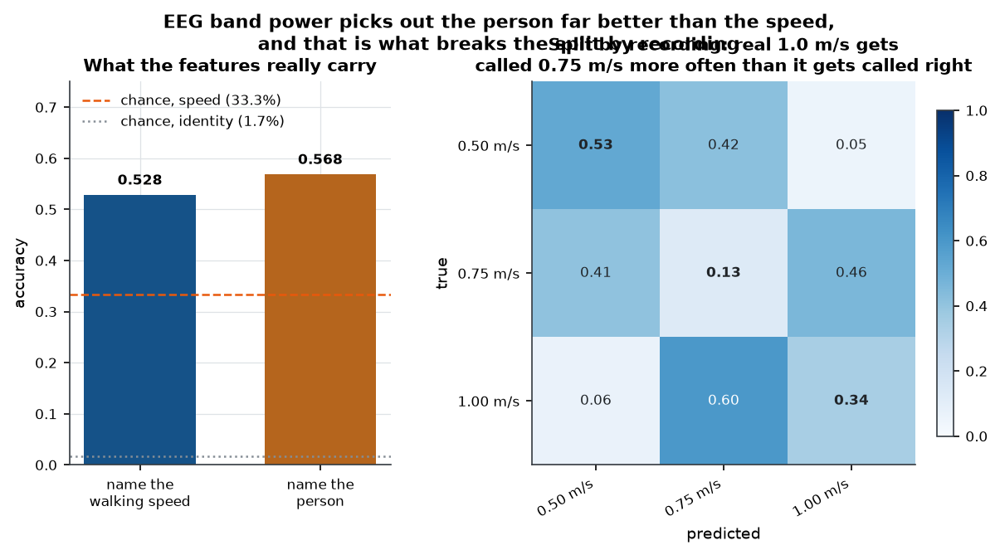
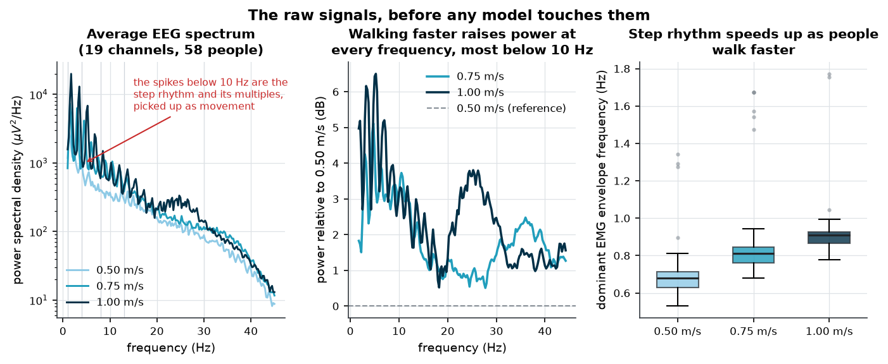
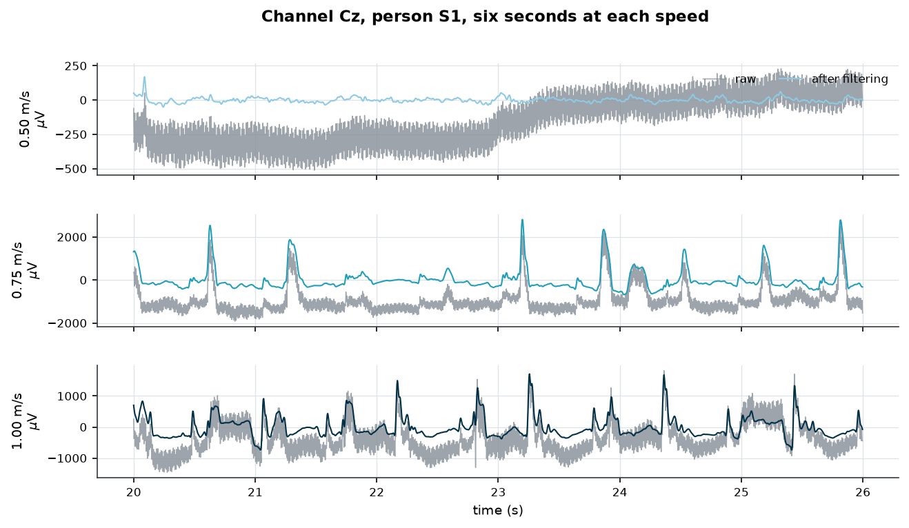
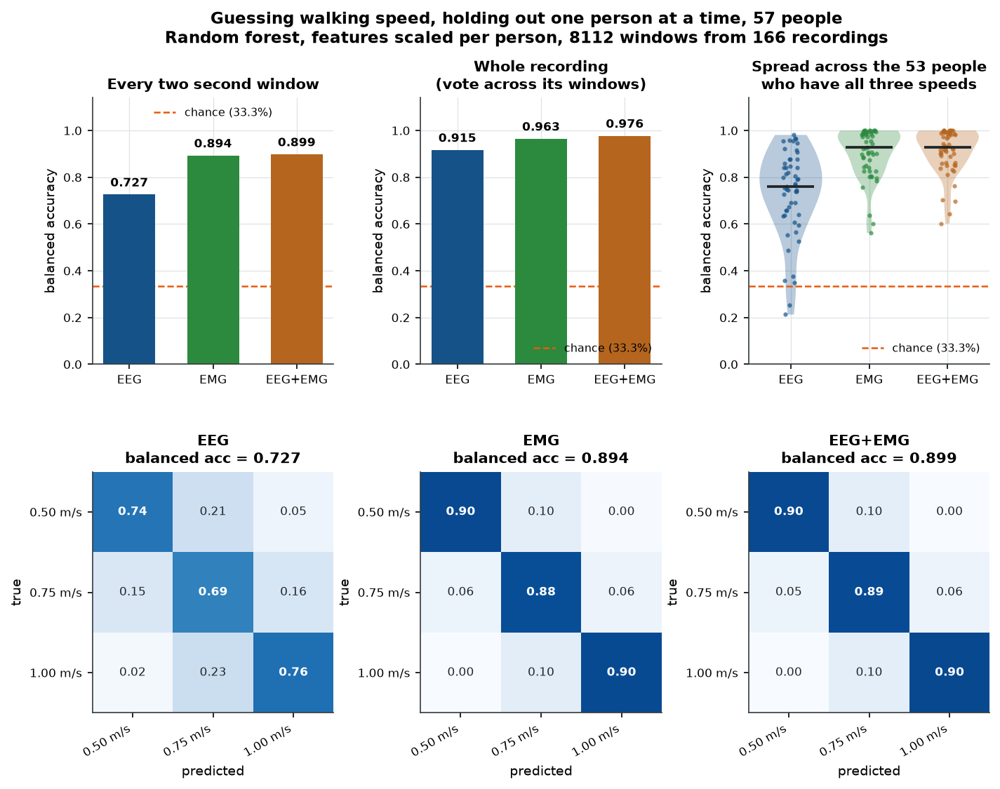
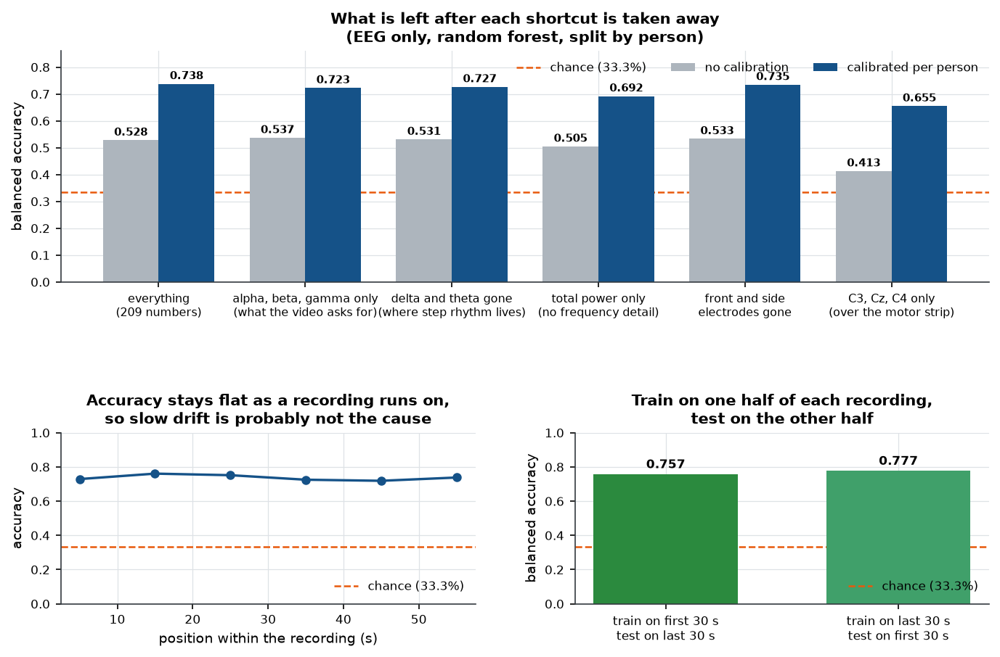
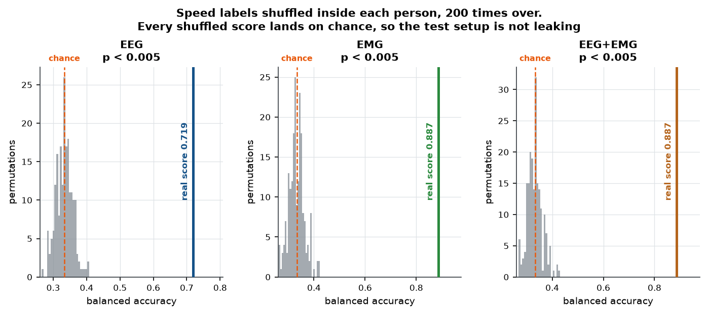
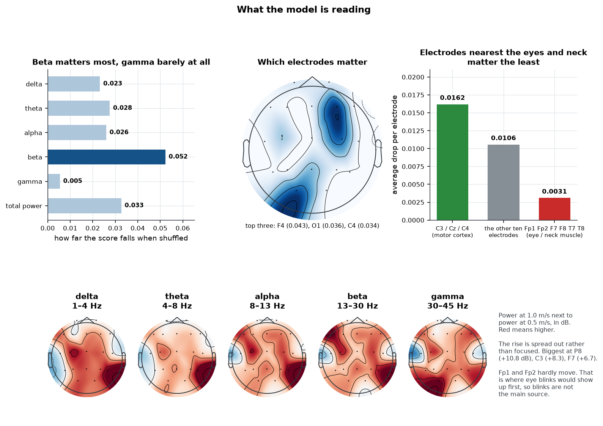
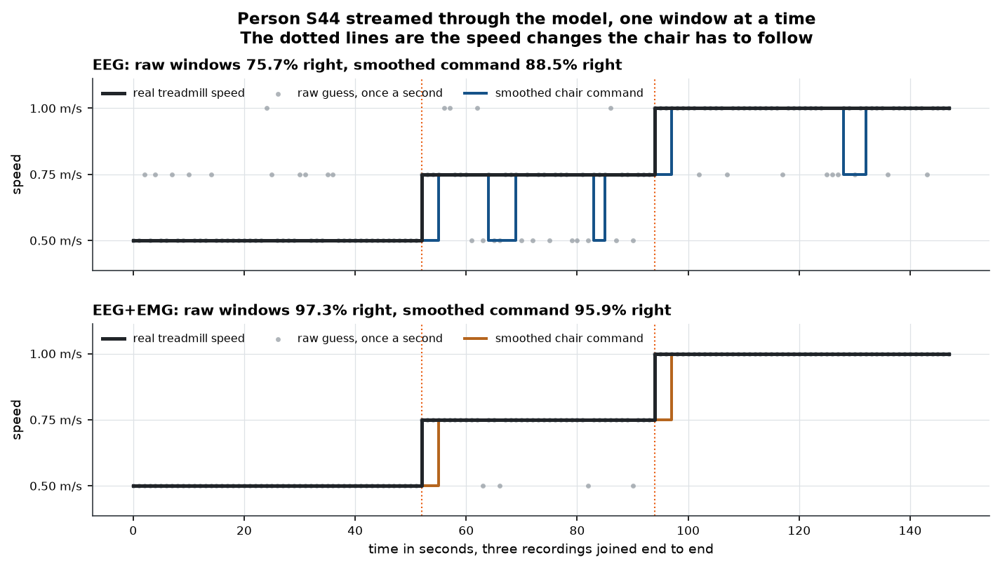

# Guessing walking speed from brain and muscle signals

## What this is

I set out to build a model that reads someone's brain waves and says how fast they are walking. The idea came from a short video that framed it as the first step towards a wheelchair you steer with your mind.

The first score I got was 0.923. That score is wrong, and most of this write-up is about why, and about what is left once the mistakes are fixed.

Short version of the answer. The honest score for brain signals alone is 0.727 per two second window when the model gets a short calibration recording from the person first, and 0.554 when it does not. Muscle signals do better at 0.893. Most of what the brain model picks up looks like body movement rather than thinking, for reasons I go through below.

## The data

The recordings come from a public dataset put out on PhysioNet by Katmah and colleagues [1]. Fifty-nine healthy adults walked on a treadmill at 0.5, 0.75 and 1.0 metres per second. While they walked, four systems recorded at once: 19 dry EEG electrodes on the scalp at 300 Hz, 12 muscle sensors on the legs, motion sensors, and force plates under the belts. Each speed lasted one minute.

I used the brain and muscle recordings. The motion and force data would make the task easy in a way that says nothing about brain signals, so I left them out.

### Getting the files ready

One person, S32, is dropped. Their 1.0 m/s brain file has a header listing channel names that do not match the other 176 files, so there is no safe way to know which column is which electrode. Dropping one of their three speeds would leave them with an uneven set, so all three go. That leaves 58 people and 174 recordings.

The recordings are stored against a reference electrode at Pz, which means there is no Pz column in the files at all. The dataset ships a short MATLAB script that fixes this by switching the reference to the average of the two earlobe electrodes and rebuilding Pz. I translated that script into Python and checked the output against it number by number before going further.

After that the signals get a linear detrend, a notch at 60 and 120 Hz to kill mains hum, and a 1 to 45 Hz band-pass. The upper edge stays below the 60 Hz mains on purpose.

Windows are two seconds long with a one second step. A window gets thrown out if any channel swings much wider than that channel normally does inside the same recording. Doing the check per recording matters, because some people had a far noisier headset fit than others, and one fixed cutoff across everyone would throw away almost all of a few people's data.

How often that happened, split by speed:

| speed | windows thrown out |
|---|---|
| 0.50 m/s | 17.5% |
| 0.75 m/s | 13.8% |
| 1.00 m/s | 16.1% |

The three numbers are close, so throwing out windows is not quietly acting as a clue about speed.

### What goes into the model

For every window and every electrode I work out how much power sits in five frequency ranges: delta (1 to 4 Hz), theta (4 to 8), alpha (8 to 13), beta (13 to 30) and gamma (30 to 45). I keep both the raw power and each band as a share of the total, plus the total itself. That comes to 209 numbers per window.

The video only asks for alpha, beta and gamma. I added delta and theta because the rhythm of the steps lands in those low bands, and I wanted to be able to take them away again later and see what happened.

The muscle files arrive already reduced to a smoothed size measure at about 16 Hz. Per window and per muscle I take the mean, the spread, the 90th percentile, and the strongest rhythm between 0.4 and 3 Hz along with how strong it is. That comes to 60 numbers. Muscle windows line up with brain windows by clock time rather than by row number, because the muscle files run 60.4 to 70.4 seconds while every brain file is exactly 59.87 seconds.

## The split is the whole experiment

Each one minute recording turns into 58 windows that overlap each other by half. Shuffle those windows and deal them into a training set and a test set at random, and windows from the same recording land on both sides. They share half their samples, so they are near copies. The model can score well by recognising a window it has already mostly seen.

Same model, same features, three ways of drawing the line:

| how the split is drawn | score | what it measures |
|---|---|---|
| at random across windows | 0.923 | very little, for the reason above |
| by recording | 0.333 | something worse than nothing, see below |
| by person | 0.528 | whether it works on someone new |

Leinonen and colleagues found the same pattern in heart recordings [11]. Ordinary k-fold cross-validation gave scores that were too high, and holding out whole sources gave honest ones.

## The features know who you are

The middle row of that table bothered me. Splitting by recording is a weaker rule than splitting by person, so it should score higher. It sits at chance instead.

So I ran the obvious check. Instead of asking the model to name the speed, I asked it to name the person. It got the right one out of 58 people 0.568 of the time, against a chance level of 1.7 percent. That is about 33 times better than guessing.

That is what breaks the recording-level split. Every person walked all three speeds once. Hold out one of their recordings and the model has already been trained on the other two, so it knows what that person looks like at the two speeds it has seen, and it puts the held-out recording into one of those. The right answer is the one speed it was never shown. In the confusion matrix, true 1.0 m/s gets called 0.75 m/s more often than it gets called correctly.

None of this is a surprise on its own. People have been identified from their EEG since at least 2007 [9], and there is a whole survey of the field [10]. What is worth saying is that a person's signature is strong enough here to swamp the thing I was actually trying to measure, and that it produces a score below chance rather than above it.

Splitting by person is the only version that answers the question a device would face. Everything after this point uses it.

## Brain, muscle, and both

These runs hold out one person at a time, across the 57 people who have both kinds of recording, which is 8112 windows from 166 recordings. A model that guesses at random scores 0.330 here, which is the check that the folds are built properly.

| signals used | per window | per recording | kappa | rank correlation |
|---|---|---|---|---|
| brain | 0.727 | 0.915 | 0.589 | 0.733 |
| muscle | 0.893 | 0.963 | 0.840 | 0.914 |
| both | 0.899 | 0.976 | 0.848 | 0.920 |

Muscle beats brain by a wide margin, and adding brain signals on top of muscle buys almost nothing. Tortora and colleagues built a gait decoder in 2020 that fused EEG and EMG classifiers and did get a gain from the combination [6]. I do not see one that size here.

The per-recording column is the number to quote for a device. A wheelchair would not act on one two second window. It would collect several seconds and then decide.

### Calibration matters more than which signal you pick

There are two ways a device could meet a new user. It could work straight out of the box, or it could record them for a minute first and use that to set its own baseline. The second version scales each feature against the spread of that person's own recordings. It never sees their labels.

| signals used | no calibration | with calibration |
|---|---|---|
| brain | 0.554 | 0.723 |
| muscle | 0.681 | 0.889 |
| both | 0.726 | 0.889 |

Taking away each person's baseline is worth more than switching from brain to muscle. There is a catch, and it is a real one. The calibration step uses the held-out person's own recordings, including the ones being tested. That describes a device that gets a calibration session, and it does not describe one that works cold.

These rows use only the people who have muscle recordings too, so the arms stay comparable. That is why the no-calibration brain score here is 0.554 rather than the 0.528 quoted earlier on the full set of windows.

## Could this be luck?

To check, I shuffled the speed labels within each person, so everyone keeps their three recordings and only the name on each one gets mixed up. Then I reran the whole thing 200 times. Shuffling the labels across everyone at once would also destroy the person structure, which would make the comparison too easy.

| signals used | real score | shuffled average | shuffled 95th | p |
|---|---|---|---|---|
| brain | 0.719 | 0.333 | 0.370 | below 0.005 |
| muscle | 0.887 | 0.333 | 0.388 | below 0.005 |
| both | 0.887 | 0.332 | 0.383 | below 0.005 |

The shuffled scores land on chance, which is the more useful half of this test. If the cross-validation were leaking anywhere, the shuffled runs would sit above chance too.

## What the model is actually reading

Walking faster means stepping faster. Step rhythm shows up in the brain recording because the head bobs and the neck muscles work, so the worry is that the model is reading footsteps off the scalp. I measured the step rhythm from the muscle files, and it does climb with speed: 0.50 m/s gives 0.68 Hz, 0.75 m/s gives 0.81 Hz, 1.00 m/s gives 0.91 Hz.

To test it I took away one suspected shortcut at a time and retrained.

| what the model gets | how many numbers | score |
|---|---|---|
| everything | 209 | 0.738 |
| alpha, beta and gamma only, as the video asks | 114 | 0.723 |
| delta and theta taken out, where step rhythm lives | 133 | 0.727 |
| total power only, no frequency detail at all | 19 | 0.692 |
| front and side electrodes taken out | 143 | 0.735 |
| C3, Cz and C4 only, over the motor strip | 33 | 0.655 |

Taking out the bands that hold the step rhythm barely dents the score, from 0.738 down to 0.727. And total power on its own, 19 numbers with no frequency detail in them, gets to 0.692. So the model is mostly reading a rise in overall power rather than a change in the shape of the spectrum.

Shuffling one band at a time and watching the score drop gives this:

| band | drop when shuffled |
|---|---|
| beta | 0.052 |
| total power | 0.033 |
| theta | 0.028 |
| alpha | 0.026 |
| delta | 0.023 |
| gamma | 0.005 |

And by electrode:

| electrodes | average drop each |
|---|---|
| C3, Cz, C4, over the motor strip | 0.0162 |
| the other ten | 0.0106 |
| Fp1, Fp2, F7, F8, T7, T8, nearest the eyes and neck | 0.0031 |

For a while I read that table the friendly way. The electrodes closest to the eyes and the neck muscles are the least useful ones, the motor strip electrodes are the most useful, and beta is the strongest band. Beta over the motor strip is a normal thing to see during movement [7, 12], so this looked like real brain activity.

### Then I found a paper that says otherwise

Nordin, Hairston and Ferris published a study in 2019 that lands directly on this question [2]. They built a dual-layer electrode setup where one layer sits on the scalp and the second layer sits on top of it, electrically separate, picking up movement only. That gave them a recording of the artifact by itself, which they could then subtract. Their participants walked at 0.5, 1.0, 1.5 and 2.0 m/s, so their two slowest speeds are my two extremes.

Two of their findings matter here. Once the artifact was removed, alpha and beta power over sensorimotor cortex went **down** as people walked faster. And the isolated movement recordings, together with the neck muscle recordings, showed broad power going **up** at faster speeds.

In my data, alpha and beta at C3, Cz and C4 go up by +6.5 dB on average between 0.5 and 1.0 m/s, and the rise is broad across the whole band. That is the same direction as their movement channel and the opposite direction from their cleaned brain signal.

So the friendly reading does not hold up. The pattern I have looks like the artifact they measured, not the cortex they measured. The honest conclusion is that most of what my model uses is body movement picked up by the electrodes.

One thing does survive. Fp1 and Fp2 sit just above the eyes, which is where blink artifact turns up first, and they barely change with speed. They were also the two least useful electrodes. So I can rule out eye blinks as the main source. Neck muscle and head movement do not stay near the front of the head, so ruling out blinks rules out very little.

The literature is split on how bad this problem is. Nathan and Contreras-Vidal reported in 2016 that motion did not affect scalp EEG much during treadmill walking, with a warning once speed approaches 4.5 km/h [3]. My fastest condition is 3.6 km/h, under that line, which would put me in the clear on their account. Jacobsen and colleagues reached a less comfortable answer in 2020 and described clear gait-related artifacts in mobile EEG [4]. Gorjan and colleagues wrote guidelines in 2022 that treat movement artifact as a problem needing active removal [5]. My results sit with the second group.

### Two smaller checks

Training on the first 30 seconds of every recording and testing on the last 30 gives 0.757. The other way round gives 0.777. Accuracy is also flat across the length of a recording. That argues against the electrodes slowly drying out being the thing that gets measured, though it does not rule it out.

Two second windows are an arbitrary pick, so I ran the whole comparison again at four seconds.

| signals used | 2 second windows | 4 second windows |
|---|---|---|
| brain | 0.723 | 0.769 |
| muscle | 0.889 | 0.884 |
| both | 0.889 | 0.899 |

Brain signals gain about four points from the longer window, which is what a noisy measurement should do when you give it twice as much data. Muscle stays flat. Brain is still the weakest of the three either way, so the conclusion does not rest on the window length.

## Running it like a wheelchair

Scores on shuffled windows are not what a device lives through. So I took one person out of the training set, S44, joined their three recordings end to end, and fed them through the model one window at a time. I picked the person whose score sits closest to the middle of the group rather than the best one. Raw guesses get smoothed by a rolling vote over 5 windows, and the command only changes after the new answer has held for two windows in a row, so one bad window cannot jolt the chair.

| signals used | raw windows right | smoothed command right | time to settle |
|---|---|---|---|
| brain | 75.7% | 88.5% | 33 s, 38 s |
| both | 97.3% | 95.9% | 3 s, 3 s |

Time to settle is how long after a speed change the command reaches the new speed and stays there. The accuracy column makes the brain-only model look usable and the settling column shows that it is not. It does reach the right speed, then falls back to the wrong one for a few seconds, over and over. Adding muscle signals brings settling down to three seconds.

For a chair, the settling time is the number that decides whether you can ride it. On brain signals alone this one would be unpleasant and probably unsafe.

### How much smoothing helps

The amount of smoothing is a free choice, so I swept it. The two sets of signals behave in opposite ways.

| smoothing windows | brain: command right | brain: settles | both: command right | both: settles |
|---|---|---|---|---|
| 1 | 84.5% | 37 s, 35 s | 98.6% | 1 s, 1 s |
| 3 | 83.8% | 38 s, 36 s | 97.3% | 2 s, 2 s |
| 5 | 88.5% | 33 s, 38 s | 95.9% | 3 s, 3 s |
| 9 | 89.2% | 20 s, 5 s | 93.2% | 5 s, 5 s |
| 12 | 90.5% | 8 s, 6 s | 91.2% | 7 s, 6 s |
| 15 | 89.9% | 9 s, 6 s | 89.2% | 8 s, 8 s |

With muscle signals in the mix the raw guesses are already right almost every second, so smoothing buys nothing and only adds delay. The best setting is no smoothing at all.

Brain signals alone do the reverse. The guesses jump around so much that at light settings the command never holds still, which is why settling sits above 30 seconds. It takes about twelve seconds of averaging before the command stops flipping, and at that point the chair is reacting to what the rider wanted twelve seconds earlier. No setting gives a command that is both steady and quick.

## What this does not show

**The recording order cannot be undone.** Every person walked 0.5, then 0.75, then 1.0, in one sitting with the headset fitted once. Speed lines up exactly with time since the session started, and so does everything that drifts with it: the dry electrodes settling, sweat, hair moving, tiredness. No amount of analysis on this dataset can pull those apart. The two checks above help a little. Settling it properly needs a study that varies the order between people.

**Most of the signal is probably movement.** The comparison with Nordin and colleagues points that way, and I have no way to remove the artifact properly without the dual-layer hardware they used.

**The calibrated numbers use the test person's own data.** No labels, but still their data. Treat them as the score for a device that gets a calibration session.

**The group is narrow.** Fifty-eight healthy adults with an average age of 24, on a treadmill, at three slow speeds. People who use wheelchairs are not this group, and a treadmill is not a pavement.

**This is not a brain-computer interface.** The people in this dataset were walking. Somebody who needs a powered chair is not. Reading an intended speed from somebody who is sitting still is a much harder problem, and nothing here shows it can be done. Reviews of EEG control for lower limb assistive robots give a sense of how far off that is [8].

## Figures

### The same model and the same features, scored three ways.



### The features tell you who someone is better than how fast they walk.



### The raw signals: EEG spectra, how they shift with speed, and step rhythm.



### One person at Cz, before and after filtering, six seconds per speed.



### EEG, EMG and both together, tested on people the model never saw.



### What is left after each shortcut is taken away.



### Shuffled labels. Every null sits on chance.



### Which bands and which electrodes the model uses.



### One held-out person streamed through the model as a speed controller.



## Running the code

```bash
uv sync
uv run python scripts/01_build_cache.py
uv run python scripts/02_explore_signals.py
uv run python scripts/03_features.py
uv run python scripts/04_experiment_leakage.py
uv run python scripts/05_experiment_main.py
uv run python scripts/06_confound_controls.py
uv run python scripts/07_permutation.py
uv run python scripts/08_interpret.py
uv run python scripts/09_realtime_demo.py
uv run python scripts/10_report.py
uv run python scripts/11_artifact.py
uv run python scripts/13_paper_pdf.py
```

Steps 5 and 7 take a while. Step 7 took just over an hour on a laptop. The rest run in seconds. Step 12 downloads the fonts the web page embeds and only needs running once. Step 13 makes the printable version and needs Chrome installed.

The dataset is not included here. Download it from PhysioNet and put the unzipped folder next to `pyproject.toml`.

## References

1. Katmah, R., AlShehhi, A., Kosaji, D., Al-Rahmani, N., Abdullah, M., Hulleck, A. A. V., and Khalaf, K. (2026). A multimodal gait dataset of brain activity, muscle activity, kinematics and ground forces in young adults (version 1.0.0). *PhysioNet*. https://doi.org/10.13026/r0ea-7161
2. Nordin, A. D., Hairston, W. D., and Ferris, D. P. (2019). Faster gait speeds reduce alpha and beta EEG spectral power from human sensorimotor cortex. *IEEE Transactions on Biomedical Engineering*. https://doi.org/10.1109/tbme.2019.2921766
3. Nathan, K., and Contreras-Vidal, J. L. (2016). Negligible motion artifacts in scalp electroencephalography (EEG) during treadmill walking. *Frontiers in Human Neuroscience*. https://doi.org/10.3389/fnhum.2015.00708
4. Jacobsen, N. S. J., Blum, S., Witt, K., and Debener, S. (2020). A walk in the park? Characterizing gait-related artifacts in mobile EEG recordings. *European Journal of Neuroscience*. https://doi.org/10.1111/ejn.14965
5. Gorjan, D., Gramann, K., De Pauw, K., and Marusic, U. (2022). Removal of movement-induced EEG artifacts: current state of the art and guidelines. *Journal of Neural Engineering*. https://doi.org/10.1088/1741-2552/ac542c
6. Tortora, S., Tonin, L., Chisari, C., Micera, S., Menegatti, E., and Artoni, F. (2020). Hybrid human-machine interface for gait decoding through Bayesian fusion of EEG and EMG classifiers. *Frontiers in Neurorobotics*. https://doi.org/10.3389/fnbot.2020.582728
7. Artoni, F., Fanciullacci, C., Bertolucci, F., Panarese, A., Makeig, S., Micera, S., and Chisari, C. (2017). Unidirectional brain to muscle connectivity reveals motor cortex control of leg muscles during stereotyped walking. *NeuroImage*. https://doi.org/10.1016/j.neuroimage.2017.07.013
8. Tariq, M., Trivailo, P. M., and Simic, M. (2018). EEG-based BCI control schemes for lower-limb assistive-robots. *Frontiers in Human Neuroscience*. https://doi.org/10.3389/fnhum.2018.00312
9. Marcel, S., and Millan, J. del R. (2007). Person authentication using brainwaves (EEG) and maximum a posteriori model adaptation. *IEEE Transactions on Pattern Analysis and Machine Intelligence*. https://doi.org/10.1109/tpami.2007.1012
10. Gui, Q., Ruiz-Blondet, M. V., Laszlo, S., and Jin, Z. (2019). A survey on brain biometrics. *ACM Computing Surveys*. https://doi.org/10.1145/3230632
11. Leinonen, T., Wong, D., Vasankari, A., Wahab, A., Nadarajah, R., Kaisti, M., and Airola, A. (2024). Empirical investigation of multi-source cross-validation in clinical ECG classification. *Computers in Biology and Medicine*. https://doi.org/10.1016/j.compbiomed.2024.109271
12. Peterson, S. M., and Ferris, D. P. (2018). Differentiation in theta and beta electrocortical activity between visual and physical perturbations to walking and standing balance. *eNeuro*. https://doi.org/10.1523/eneuro.0207-18.2018
